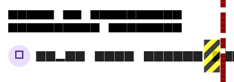
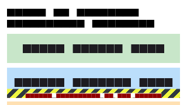
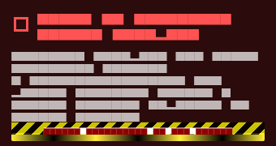

# Week 04: Constraint Diagnosis & Overflow Anatomy

In Flutter, widget layout is governed by one fundamental rule:

> **"Constraints go down. Sizes go up. Parent sets position."**

When a widget attempts to violate this contract—either by requesting an unbounded dimension where finite bounds are required, or by rendering a child larger than its allocated parent constraint—Flutter's layout engine halts the layout pass and paints yellow-and-black hazard warning stripes.

Below are three deliberately reproduced constraint violations from the **EcoHome Smart Hub**, with diagnosis and fixes.

---

## Error 1: Horizontal RenderFlex Overflow (Unbounded Row Child)

### Screenshot


```
════════════════════════════════════════════════════════════════════════════════
══╡ EXCEPTION CAUGHT BY RENDERING LIBRARY ╞═════════════════════════════════════
The following assertion was thrown during layout:
A RenderFlex overflowed by 214 pixels on the right.

The relevant error-causing widget was:
  Row
════════════════════════════════════════════════════════════════════════════════
```

### Constraint Rule Violated (One Sentence)
> **A `Row` passes unconstrained width (`maxWidth: double.infinity`) to its children, allowing an unconstrained `Text` widget to size itself to its full natural text width rather than fitting within the parent's finite horizontal boundary.**

### Deliberate Problematic Code
```dart
// lib/widgets/device_control_tile.dart (Flawed)
Row(
  children: [
    CircleAvatar(radius: 16, child: Icon(Icons.ac_unit)),
    const SizedBox(width: 8),
    // Text calculates intrinsic width for 200 characters -> exceeds screen width!
    Text(
      'Super Long Living Room Climate Master Control Unit ' * 3,
      style: TextStyle(fontSize: 14),
    ),
    Switch(value: true, onChanged: (_) {}),
  ],
)
```

### The Fix
```dart
// lib/widgets/device_control_tile.dart (Fixed)
Row(
  children: [
    CircleAvatar(radius: 16, child: Icon(Icons.ac_unit)),
    const SizedBox(width: 8),
    // Expanded forces the Row to pass bounded maxWidth down to the Text
    Expanded(
      child: Text(
        'Super Long Living Room Climate Master Control Unit ' * 3,
        style: const TextStyle(fontSize: 14),
        maxLines: 1,
        overflow: TextOverflow.ellipsis,
      ),
    ),
    const SizedBox(width: 8),
    Switch(value: true, onChanged: (_) {}),
  ],
)
```

**Why it works:** Wrapping `Text` in `Expanded` tells the `Row` to measure the un-flexed siblings first (`CircleAvatar`, `SizedBox`, `Switch`), compute the remaining available width, and pass that bounded `maxWidth` to `Text`. Setting `overflow: TextOverflow.ellipsis` ensures graceful truncation without yellow stripes.

---

## Error 2: Vertical RenderFlex Overflow on Short Viewport

### Screenshot


```
════════════════════════════════════════════════════════════════════════════════
══╡ EXCEPTION CAUGHT BY RENDERING LIBRARY ╞═════════════════════════════════════
The following assertion was thrown during layout:
A RenderFlex overflowed by 170 pixels on the bottom.

The relevant error-causing widget was:
  Column
════════════════════════════════════════════════════════════════════════════════
```

### Constraint Rule Violated (One Sentence)
> **A non-scrollable `Column` enforces a tight vertical constraint matching its parent container, but its children calculate intrinsic heights that sum to more than the parent's maximum allowed height.**

### Deliberate Problematic Code
```dart
// lib/screens/smart_home_screen.dart (Flawed fixed layout)
Scaffold(
  body: Container(
    height: 180, // or viewport when on-screen keyboard appears
    child: Column(
      children: [
        Container(height: 50, child: Text('Power Metric Card')),
        Container(height: 50, child: Text('Active Devices Card')),
        Container(height: 50, child: Text('Quick Mode Selector')),
        Container(height: 50, child: Text('Room Category Tabs')),
      ], // 50 * 4 = 200 dp > 180 dp allocated -> 20 dp bottom overflow!
    ),
  ),
)
```

### The Fix
```dart
// lib/screens/smart_home_screen.dart (Fixed with slivers & scrollable viewport)
Scaffold(
  resizeToAvoidBottomInset: true,
  body: CustomScrollView(
    keyboardDismissBehavior: ScrollViewKeyboardDismissBehavior.onDrag,
    slivers: [
      SliverToBoxAdapter(child: Container(height: 50, child: Text('Power Metric Card'))),
      SliverToBoxAdapter(child: Container(height: 50, child: Text('Active Devices Card'))),
      SliverToBoxAdapter(child: Container(height: 50, child: Text('Quick Mode Selector'))),
      SliverToBoxAdapter(child: Container(height: 50, child: Text('Room Category Tabs'))),
    ],
  ),
)
```

**Why it works:** By converting the static `Column` into a scrollable viewport (`CustomScrollView`), the parent grants an unbounded scroll extent in the vertical direction (`maxHeight: double.infinity`), allowing all children to lay out at their intrinsic heights while enabling fluid vertical scrolling whenever the screen is short or compressed by the keyboard.

---

## Error 3: Unbounded Viewport Height Exception (`ListView` inside `Column`)

### Screenshot


```
════════════════════════════════════════════════════════════════════════════════
══╡ EXCEPTION CAUGHT BY RENDERING LIBRARY ╞═════════════════════════════════════
The following assertion was thrown during layout:
Vertical viewport was given unbounded height.

Viewports expand in the scrolling direction to fill their container. In this case,
a vertical viewport was given an unlimited amount of vertical space in which to expand.
════════════════════════════════════════════════════════════════════════════════
```

### Constraint Rule Violated (One Sentence)
> **A scrollable viewport requires a bounded constraint along its scroll axis to determine its viewport dimensions, but an unconstrained parent `Column` passes an infinite vertical constraint (`maxHeight: double.infinity`), violating the rule that scrollable widgets must have finite constraints along their scroll axis.**

### Deliberate Problematic Code
```dart
// lib/screens/smart_home_screen.dart (Flawed nested scrollable)
Column(
  children: [
    HeaderGreeting(...),
    // ListView defaults to expanding vertically, but Column gives it infinite height!
    ListView.builder(
      itemCount: 500,
      itemBuilder: (context, index) => DeviceControlTile(...),
    ),
  ],
)
```

### The Fix
```dart
// lib/screens/smart_home_screen.dart (Fixed via unified CustomScrollView)
CustomScrollView(
  slivers: [
    SliverToBoxAdapter(
      child: HeaderGreeting(...),
    ),
    // SliverGrid.builder/SliverList.builder integrates directly into the viewport
    // No shrinkWrap: true needed; renders 500 items lazily with zero overhead!
    SliverPadding(
      padding: const EdgeInsets.symmetric(horizontal: 20.0),
      sliver: SliverGrid.builder(
        itemCount: filteredList.length,
        gridDelegate: const SliverGridDelegateWithFixedCrossAxisCount(
          crossAxisCount: 2,
          crossAxisSpacing: 12,
          mainAxisSpacing: 12,
          childAspectRatio: 1.08,
        ),
        itemBuilder: (context, index) => DeviceControlTile(device: filteredList[index], ...),
      ),
    ),
  ],
)
```

**Why it works:** Rather than hacking the `ListView` with `shrinkWrap: true` (which forces layout of all 500 items simultaneously and wastes CPU/RAM), the screen is unified into a single `CustomScrollView`. The `SliverGrid.builder` receives the scrolling viewport constraints directly from `CustomScrollView`, rendering only visible items on demand without unbounded height errors.
