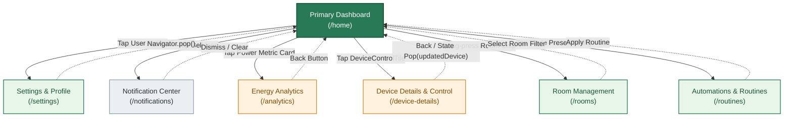

# Week 04: Screen Map & Navigation Blueprint for Week 05

## Overview & Architecture

The **EcoHome Smart Hub** currently features an adaptive primary dashboard (`SmartHomeScreen`) that allows users to monitor real-time energy telemetry, toggle quick preset modes, filter by room, and control smart appliances.

In **Week 05**, the app will be wired into a multi-screen navigation architecture supporting deep linking, modal detail sheets, and unidirectional state passing. This document provides the complete screen inventory, navigation flowchart, and routing contract.

---

## Screen Inventory

| Screen Name | Route Path | Trigger / Origin | Purpose & Key Features | Parameters Passed |
| :--- | :--- | :--- | :--- | :--- |
| **Primary Dashboard** | `/` or `/home` | App Launch | Central control hub; energy telemetry, mode selector, room filters, device grid, search, dark mode toggle. | None (Root route) |
| **Device Details & Control** | `/device-details` | Tap on any `DeviceControlTile` | Granular device controls (temperature slider for AC, brightness & RGB for lamps, timer, power consumption graph). | `deviceId: String`, `device: SmartDevice` |
| **Energy Analytics** | `/analytics` | Tap on `StatMetricCard` ("Current Power") | Historical energy usage (daily, weekly, monthly charts), tariff cost calculator ($/kWh), carbon footprint index. | `currentWatts: double` |
| **Room Management** | `/rooms` | Tap on `CategoryFilterTabs` ("Manage Rooms") | List of household rooms, active device count per room, bulk room power-off action, add/rename room. | `selectedRoom: String` |
| **Automations & Routines** | `/routines` | Tap on "Quick Modes" settings or drawer | Pre-configured automations (e.g. "Eco mode when Away", "Turn off AC at 7 AM"), custom automation rule builder. | `activeMode: String` |
| **Settings & Profile** | `/settings` | Tap on user avatar in `HeaderGreeting` | User profile (`Andi Arjuna`), energy tariff rate configuration, hub Wi-Fi status, theme selection. | None |
| **Notification Center** | `/notifications` | Tap on Notification badge in `HeaderGreeting` | Chronological activity log ("Kitchen Smart Oven left on for 2 hours", "High power usage alert"). | None |

---

## Screen Map Flowchart (Mermaid)



---

## Navigation ASCII Wireframe

```
                     +---------------------------+
                     |    Settings & Profile     |
                     |         (/settings)       |
                     +---------------------------+
                                   ^
                           [Tap User Avatar]
                                   |
+---------------------+     +---------------------------+     +-----------------------+
| Notification Center | <-- |     PRIMARY DASHBOARD     | --> |    Energy Analytics   |
|   (/notifications)  |     |          (/home)          |     |      (/analytics)     |
+---------------------+     +---------------------------+     +-----------------------+
    [Tap Bell Icon]                   |            |           [Tap Power Stat Card]
                                      |            |
                 +--------------------+            +-------------------+
                 | [Tap Device Tile]                   | [Long-press Chip]
                 v                                     v
+-------------------------------+             +---------------------------+
|    Device Details & Control   |             |      Room Management      |
|       (/device-details)       |             |          (/rooms)         |
+-------------------------------+             +---------------------------+
                 |                                     |
                 +-------------------------------------+
                                   |
                           [Configure Modes]
                                   v
                     +---------------------------+
                     |   Automations & Routines  |
                     |        (/routines)        |
                     +---------------------------+
```

---

## Week 05 Wiring Implementation Plan

### 1. Routing Setup
We will define declarative routes in `main.dart` (or via Flutter's `Navigator 1.0` / `MaterialPageRoute` factory):

```dart
final Map<String, WidgetBuilder> appRoutes = {
  '/': (context) => const SmartHomeScreen(),
  '/device-details': (context) {
    final device = ModalRoute.of(context)!.settings.arguments as SmartDevice;
    return DeviceDetailScreen(device: device);
  },
  '/analytics': (context) => const EnergyAnalyticsScreen(),
  '/rooms': (context) => const RoomManagementScreen(),
  '/routines': (context) => const RoutinesScreen(),
  '/settings': (context) => const SettingsScreen(),
  '/notifications': (context) => const NotificationCenterScreen(),
};
```

### 2. Parameter Passing & Return Data Contracts
When navigating from a `DeviceControlTile` on the dashboard to `/device-details`:
- **Forward Pass**: The clicked `SmartDevice` instance is passed as route arguments.
- **Return Pass**: Users can toggle device power, adjust thermostat setpoints, or schedule timers on the detail screen. Tapping the back button calls:
  ```dart
  Navigator.pop(context, updatedDevice);
  ```
- **State Reconciliation**: The dashboard listens to the `Future` returned by `Navigator.pushNamed`, updating the parent `_devices` list and recalculating aggregate kilowatt power metrics automatically.

### 3. Adaptive Tablet Experience in Week 05
On tablet screens (`constraints.maxWidth >= 720 dp`), rather than pushing full-screen route replacements, `/device-details` will open as an interactive **Side Sheet** (or right-hand split view pane), maintaining the user's dashboard context while enabling rapid appliance control!
